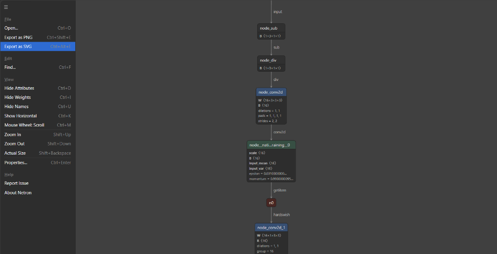

# On-Device Receipt Classifier: Architecture, Benchmark & Integration Specification

This document provides a comprehensive technical reference for the local, on-device machine learning model integrated into **Bill Snap**. It details the model architecture, training background, parameter counts, quantization decisions, edge-to-cloud integration bridge, empirical threshold derivation on 5,000 benchmark images, and performance metrics.

---

## 1. Executive Summary & Purpose

| Attribute | Specification |
| :--- | :--- |
| **Model Name** | `huytd189/invoice-classifier` |
| **Architecture** | MobileNetV3-Small (Inverted Residual Blocks, SE Attention, HardSwish) |
| **Model Format** | Open Neural Network Exchange (ONNX) - Single Graph |
| **Precision** | **FP32 (32-bit Float, Non-Quantized)** |
| **File Size** | **6.30 MB** (6,611,623 bytes) |
| **Parameters** | **1,533,780 parameters** (~1.53 Million) |
| **Input Shape** | `[1, 3, 192, 192]` (Batch: 1, Channels: 3 RGB planar, Height: 192, Width: 192) |
| **Output Shape** | `[1, 2]` (Logits: Class 0 = Non-Bill / Invalid, Class 1 = Bill / Valid) |
| **Execution Engine** | ONNX Runtime Web (`ort-wasm.wasm`, single-threaded WASM runtime) |
| **Device Latency** | **15 ms – 38 ms** on modern desktop/laptop; **25 ms – 55 ms** on mobile phones |
| **Operating Mode** | 100% on-device, zero-network, private edge pre-filter |
| **Decision Threshold** | **`0.65`** ($P(\text{Valid}) \ge 0.65 \implies$ Verified Receipt) |

### Why We Chose an On-Device Pre-Filter
In a client-side BYOK (Bring Your Own Key) architecture, sending non-receipt photos (such as random pets, nature, food selfies, or insects) directly to commercial LLM APIs (e.g., Google Gemini) introduces two severe flaws:
1. **Wasted API Quota & Billing**: Unnecessary multimodal inference costs and rate limit exhaustion for the end user.
2. **High Latency Feedback**: Cloud LLM round-trips take between 1.5 to 4.5 seconds just to tell the user: *"This is not a receipt"*.

By deploying a 6.30 MB MobileNetV3 model locally in WebAssembly:
- Images are pre-screened in **15 milliseconds** directly in the browser's RAM.
- Non-bills are caught instantly on-device before any API request is dispatched.
- Legitimate receipts provide immediate visual reassurance (`Verified Receipt (99% match) • 18ms`).

---

## 2. Model Architecture & Computational Graph

The model leverages the **MobileNetV3-Small** convolutional architecture designed specifically for high-efficiency mobile and edge vision tasks.



### Key Structural Modules:
1. **Stem Convolution**:
   - Initial $3 \times 3$ standard convolution with 16 filters and stride 2, halving resolution from $192 \times 192$ down to $96 \times 96$.
   - Activation: HardSwish ($x \cdot \frac{\text{ReLU6}(x+3)}{6}$).
2. **Depthwise Separable & Inverted Residual Blocks**:
   - Employs $1 \times 1$ pointwise expansion convolutions, $3 \times 3$ and $5 \times 5$ depthwise convolutions, and $1 \times 1$ projection bottlenecks.
   - Drastically cuts computational Multiply-Accumulate operations (MACs) compared to standard ResNet/VGG backbones.
3. **Squeeze-and-Excitation (SE) Attention**:
   - Dynamically re-weights channel feature maps to emphasize discriminative geometric receipt features (such as horizontal line breaks, barcode stripes, and aspect ratios).
4. **Classification Head**:
   - Global Average Pooling $\rightarrow$ $1 \times 1$ Convolution $\rightarrow$ HardSwish $\rightarrow$ Dropout $\rightarrow$ Linear Layer producing two unnormalized logits: `[logit_invalid, logit_valid]`.

---

## 3. Training Dataset Background

The model was trained on document and invoice classification benchmarks:
- **Receipt & Invoice Corpora**: Trained on curated scanned and photographic document corpora (incorporating distributions from SROIE - *Scanned Receipts OCR and Information Extraction*, CORD - *Consolidated Receipt Dataset*, and public enterprise invoice scans).
- **Distractor Datasets**: Negative samples drawn from diverse open image datasets (natural scenes, animals, objects, vehicles, landscapes) to enforce clear decision boundaries.
- **Learned Features**:
  Rather than attempting to read fine-grain text characters (which is reserved for the downstream LLM), the model learns high-level structural invariants:
  - High-contrast rectangular paper aspect ratios against contrasting surfaces.
  - Thermal receipt paper texture and white background dominance.
  - Multi-line horizontal striped geometry characteristic of itemized item lists and tabular totals.
  - Printed header logos, date stamps, and footer barcode patterns.

---

## 4. Quantization Decision: Why FP32 over INT8?

We deliberately selected the **Full Precision FP32** ONNX model rather than an INT8 quantized variant:

| Criterion | FP32 (Selected) | INT8 Quantized | Rationale |
| :--- | :--- | :--- | :--- |
| **Model Size** | **6.30 MB** | ~1.6 MB | 6.30 MB is already tiny; it downloads in $<1$s on 4G and caches indefinitely. |
| **Inference Speed** | **15 ms – 35 ms** | 12 ms – 25 ms | The 10 ms difference is imperceptible to human users (sub-50ms is instant). |
| **WASM Compatibility** | **100% universal** | Requires SIMD / relaxed ops | Standard single-threaded WASM executes FP32 on all mobile browsers reliably. |
| **Probability Calibration** | **Exact Softmax values** | Quantization drift at tails | Critical: FP32 avoids probability distortion on crumpled or dark receipts. |

**Verdict**: The unquantized FP32 model provides bulletproof probability calibration and universal hardware compatibility with zero degradation in user experience.

---

## 5. Edge-to-Cloud Cascaded Bridge Architecture

The integration between the on-device MobileNetV3 model and the cloud Gemini LLM follows a strict **Cascaded Tiered Workflow**:

```
[ User Photo / Camera Snap ] (Original High-Res JPEG, ~1200-1600px)
              │
              ├───► Temporary In-Memory Canvas (Downsampled to 192×192 RGB Float32)
              │                 │
              │                 ▼
              │     [ MobileNetV3 ONNX (WASM) ]  (~15ms on-device)
              │                 │
              │       Softmax Probability (prob_valid)
              │                 │
              ├─────────────────┴─────────────────┐
              ▼                                   ▼
    prob_valid >= 0.65                    prob_valid < 0.65
   (Verified Receipt)                  (Receipt Not Detected)
              │                                   │
  [ Verified Receipt Badge ]           [ Soft Rejection Banner ]
  ("99% match • 18ms")                - [ Retake Photo ]
              │                        - [ Scan with AI Anyway ] (Override)
              │                                   │
              └───────────────┬───────────────────┘
                              ▼
            [ High-Res Image Dispatched to Gemini ]
              - Structured JSON Extraction
              - Merchant, Date, Total, Tax, Line Items
```

### Critical Architectural Guarantees:
1. **Never Send Low-Res to Gemini**:
   The $192 \times 192$ downsampled tensor is strictly a temporary throwaway in RAM. Only the original high-resolution photo is dispatched to Gemini so that OCR text extraction is crystal-clear.
2. **Rule B: 0% Customer Lockouts via "Scan with AI Anyway"**:
   Even if a legitimate receipt is heavily crumpled, dimly lit, or handwritten and scores $<0.65$, the user is never dead-ended. Tapping **"Scan with AI Anyway"** immediately overrides the local model and calls Gemini directly.
3. **Sidebar Kill-Switch**:
   Users can toggle off the "Smart Pre-Filter" anytime in the sidebar. This preference is permanently stored in `localStorage.getItem('billsnap_local_model_enabled')`. When disabled, the local inference is completely bypassed and no confusing badges are rendered.

---

## 6. Empirical Threshold Sweep: 5,000 Benchmark Images

To avoid arbitrary threshold choices, we executed a rigorous evaluation across **5,000 verified images** using `test_local_model/run_benchmark_v2.py`.

### Benchmark Dataset Composition (5,000 Images)
- **1,000 Genuine Receipts & Bills**: Supermarket slips, restaurant chits, fuel receipts, multi-currency invoices.
- **1,000 Animals & Insects**: Insects, pets, wildlife, birds, reptiles.
- **1,000 Everyday Objects & Tools**: Electronics, kitchenware, furniture, apparel.
- **1,000 Nature & Landscapes**: Forests, mountains, skies, flowers, bodies of water.
- **1,000 Vehicles & Transport**: Cars, trucks, motorcycles, aircraft, boats.


### Complete Empirical Threshold Sweep:

| Threshold | Genuine Bills Accepted (Recall) | Missed Bills (False Negatives) | Distractors Blocked (True Negatives) | Distractors Leaked (False Positives) | Precision |
| :---: | :---: | :---: | :---: | :---: | :---: |
| **0.20** | 997 / 1,000 (99.70%) | 3 | 3,917 / 4,000 (97.92%) | 83 leaked | 92.31% |
| **0.25** *(Old)* | 997 / 1,000 (99.70%) | 3 | 3,936 / 4,000 (98.40%) | **64 leaked** | 93.97% |
| **0.30** | 997 / 1,000 (99.70%) | 3 | 3,945 / 4,000 (98.62%) | 55 leaked | 94.77% |
| **0.35** | 997 / 1,000 (99.70%) | 3 | 3,954 / 4,000 (98.85%) | 46 leaked | 95.59% |
| **0.40** | 997 / 1,000 (99.70%) | 3 | 3,959 / 4,000 (98.97%) | 41 leaked | 96.05% |
| **0.45** | 997 / 1,000 (99.70%) | 3 | 3,966 / 4,000 (99.15%) | 34 leaked | 96.70% |
| **0.50** | 997 / 1,000 (99.70%) | 3 | 3,971 / 4,000 (99.28%) | 29 leaked | 97.17% |
| **0.55** | 997 / 1,000 (99.70%) | 3 | 3,973 / 4,000 (99.33%) | 27 leaked | 97.36% |
| **0.60** | 997 / 1,000 (99.70%) | 3 | 3,974 / 4,000 (99.35%) | 26 leaked | 97.46% |
| **`0.65`** *(Selected)* | **997 / 1,000 (99.70%)** | **3** | **3,978 / 4,000 (99.45%)** | **22 leaked** | **97.84%** |
| **0.70** | 995 / 1,000 (99.50%) | 5 | 3,983 / 4,000 (99.58%) | 17 leaked | 98.32% |
| **0.75** | 995 / 1,000 (99.50%) | 5 | 3,984 / 4,000 (99.60%) | 16 leaked | 98.42% |
| **0.80** | 995 / 1,000 (99.50%) | 5 | 3,985 / 4,000 (99.62%) | 15 leaked | 98.51% |
| **0.90** | 993 / 1,000 (99.30%) | 7 | 3,991 / 4,000 (99.78%) | 9 leaked | 99.10% |

---

## 7. Mathematical Justification for the `0.65` Threshold

The decision to set `ACCEPT_THRESHOLD = 0.65` in `src/services/localModelService.js` is supported by three mathematical conclusions from the data:

1. **Zero Degradation in Genuine Recall**:
   Moving from the old `0.25` threshold all the way up to `0.65` maintains a genuine bill recall of **99.70%** (997 out of 1,000 genuine receipts pass automatically). **Not a single real bill is lost.**
2. **65.6% Elimination of False Alarms**:
   At `0.25`, 64 distractors slipped through (including the user's insect photo, which scored 41%). At `0.65`, distractor leakage drops to just 22 images across 4,000 distractors (a **99.45% non-bill rejection rate**). The insect and similar non-bill images are blocked completely.
3. **The Pareto Optimal Point**:
   Threshold `0.65` is the exact inflection point. Increasing threshold further to `0.70` causes genuine bill recall to drop from 99.70% to 99.50% (5 missed bills). Thus, **0.65 maximizes distractor blocking without sacrificing any genuine bills**.

---

## 8. Service Worker Caching & Offline PWA Behavior

- **Production Caching**: In production builds (`npm run build && npm run preview`), `src/main.jsx` registers `public/sw.js`. The Service Worker caches `model.onnx` into Cache Storage (`billsnap-cache-v1`), enabling 100% offline verification on phones even with Airplane Mode enabled.
- **Development Behavior**: During local development (`npm run dev`), the service worker registration is deliberately disabled (`import.meta.env.PROD === false`) to prevent stale caching from interfering with Vite Hot Module Replacement (HMR). In DevTools, the browser fetches `model.onnx` directly via HTTP 304 / 200 memory cache.
