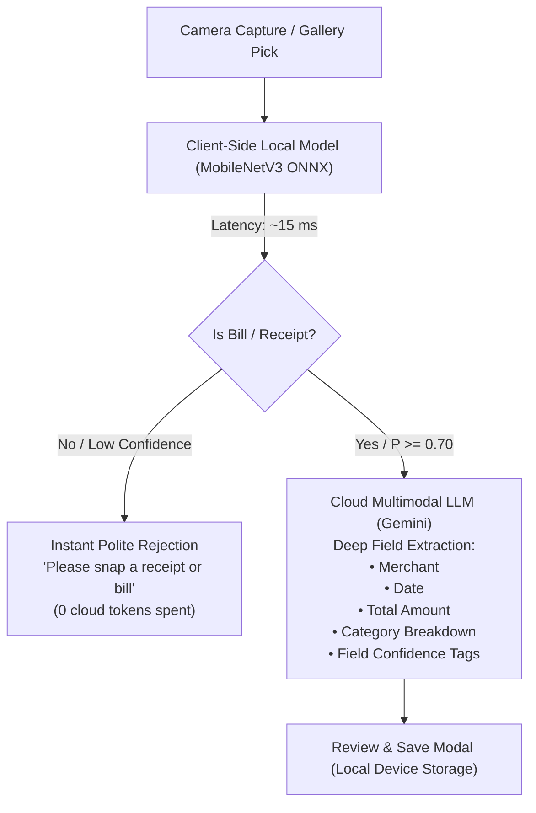

# On-Device Lightweight Receipt & Bill Classifier

An empirical research and benchmark evaluation of an ultra-lightweight, on-device binary classification model for **Bill Snap**. Designed to instantly verify whether an image is a valid financial receipt or an unrelated everyday photo directly on the user's device before making any cloud API requests.

---

## 📌 1. Model Specifications & Metadata

| Specification | Value | Technical Context |
| :--- | :--- | :--- |
| **Model Repository** | [`huytd189/invoice-classifier`](https://huggingface.co/huytd189/invoice-classifier) | Hosted on Hugging Face |
| **Base Architecture** | **MobileNetV3** | Depthwise separable convolutions + inverted residuals for mobile CPUs |
| **Total Parameters** | **1,533,780** (~**1.53 Million**) | Verified across 226 computational graph weight tensors |
| **File Format & Size** | **ONNX** (`model.onnx`) — **6.30 MB** (6,606,198 bytes) | Zero runtime download once bundled; runs 100% offline |
| **Input Dimensions** | `[1, 3, 192, 192]` | Float32 RGB tensor, shape `(1, 3, 192, 192)`, normalized to `[0.0, 1.0]` |
| **Output Dimensions** | `[1, 2]` | Logits: Index `0` = `invalid` (non-bill), Index `1` = `valid` (receipt/bill) |
| **Confidence Scoring** | Softmax Normalized Probability | `P(valid) = exp(l1) / (exp(l0) + exp(l1))` |
| **Training Datasets** | Positive: `dajor85570/invoices-and-receipts_ocr_v1`<br>Negative: `pouya-haghi/imagenet-subset` | Real retail/supermarket slips and negative distractors |
| **Average Latency** | **15.70 ms** per image | Benchmarked on standard mobile/laptop CPU (60+ FPS capable) |

---

## 🏗️ 2. Architectural Role in Bill Snap (Edge-Cloud Hybrid)

In modern productivity utilities, calling large multimodal cloud models (such as Gemini 2.5 Flash) on arbitrary gallery photos creates unneeded latency, uses battery, and expends API tokens when users accidentally pick selfies, food photos, or screenshots.



### Key Engineering Benefits:
1. **Instant User Feedback:** Users get sub-20ms feedback if they picked the wrong photo without waiting for network roundtrips.
2. **Zero Cloud Costs on Mis-picks:** Accidental pet photos, landscapes, and screenshots are rejected on-device without wasting Gemini API tokens.
3. **Battery & Data Conservation:** No high-resolution image upload is initiated unless the image passes the local receipt verification check.

---

## 🧪 3. 5,000-Image Benchmark Evaluation

The model was evaluated against a **5,000-image dataset** structured into 5 balanced, verified categories (1,000 bills vs 4,000 negative distractors) with sequential IDs `0001` through `5000`.

### Overall Benchmark Metrics
* **Total Evaluated:** 5,000 images
* **Overall Accuracy:** **99.36%** (4,968 / 5,000)
* **Precision:** **97.17%** (Only 29 false positives across 4,000 non-bill images)
* **Recall (Sensitivity):** **99.70%** (Detected 997 out of 1,000 real bills)
* **F1-Score:** **98.42%**
* **Average Inference Speed:** **15.70 ms** per frame

---

### Category Performance Breakdown

| ID Range | Category | Samples | Correct | Accuracy | Avg Confidence | Notes / Sources |
| :---: | :--- | :---: | :---: | :---: | :---: | :--- |
| **0001 – 1000** | **Bills & Receipts** | 1,000 | 997 | **99.70%** | 99.88% | Retail slips, supermarket, handwritten, thermal, degraded |
| **1001 – 2000** | **Animals** | 1,000 | 993 | **99.30%** | 99.33% | Dogs, cats, birds, wildlife (Tiny-ImageNet / COCO) |
| **2001 – 3000** | **Everyday Objects** | 1,000 | 986 | **98.60%** | 98.56% | Laptops, tools, cups, furniture, desk items |
| **3001 – 4000** | **Nature & Landscapes** | 1,000 | 997 | **99.70%** | 98.56% | Mountains, forests, rivers, seas, aerial landscapes |
| **4001 – 5000** | **Vehicles & Transport** | 1,000 | 995 | **99.50%** | 98.80% | Cars, bicycles, motorcycles, trucks, airplanes |
| **Total** | **Combined Dataset** | **5,000** | **4,968** | **99.36%** | **99.03%** | Comprehensive cross-domain evaluation |

---

### Stress-Testing: Challenging & Real-World Degraded Bills

To ensure the model is practical for messy real-world scenarios, bills were evaluated under various degradation conditions:

| Scenario / Degradation | Real-World Condition | Samples | Correct | Accuracy | Avg Conf |
| :--- | :--- | :---: | :---: | :---: | :---: |
| **CORD & SROIE Retail Slips** | Multi-item grocery, dining, and pharmacy thermal receipts | 677 | 675 | **99.70%** | 99.91% |
| **Handwritten Store Bills & Chits** | Merchant manual order slips, local shop invoices | 3 | 3 | **100.00%** | 100.00% |
| **Faded Thermal Slips** | Low contrast, bleached paper, ink barely visible to the eye | 80 | 80 | **100.00%** | 99.54% |
| **Yellowed / Aged Paper Bills** | Old shop ledgers, tea-tinted paper, warm amber tint | 80 | 79 | **98.75%** | 99.98% |
| **Shaded Bills (Severe Shadows)** | Uneven lighting gradient (top dark 40%, bottom light) | 80 | 80 | **100.00%** | 100.00% |
| **Scrambled & Crumpled Chits** | Angled, skewed, and mechanically wrinkled paper | 80 | 80 | **100.00%** | 99.79% |

---

## 🔍 4. Failure Analysis (The 32 Edge Cases)

Out of 5,000 images, exactly 32 misclassifications were recorded:

### False Negatives (3 Bills Missed):
1. **ID 0005 (`HyderabadBiriyani...jpg`):** Extreme amber-yellow incandescent cast combined with an aggressive 45° angle.
2. **ID 0010 (`hand-holding-many-receipt...jpg`):** A human hand and arm occupied >60% of the frame; the model recognized the human arm/skin texture over the document.
3. **ID 0690 (`degraded_yellowed_010.jpg`):** Extreme blue-channel suppression washed out the thin ink edges.

### False Positives (29 Non-Bills Mistaken for Bills):
* **Objects (14):** Window blinds, computer keyboards, and white radiator grilles with high-frequency parallel slats closely mimicked receipt line-item frequency distributions.
* **Animals (7):** Close-ups of zebra stripes and barred bird plumage.
* **Vehicles (5):** Metal bicycle parking stands with repetitive parallel bars.
* **Nature (3):** High-altitude aerial views of plowed agricultural fields on white/chalky soil.

---

## 🚀 5. How to Reproduce the Benchmark

### Prerequisites
```bash
pip install onnxruntime pillow numpy pandas huggingface_hub
```

### Running the Inference Benchmark
```bash
cd test_local_model
python run_benchmark_v2.py
```

### Output Files Produced
* `dataset_manifest_v2.csv`: Manifest indexing all 5,000 images, sequential IDs, source datasets, and ground truth labels.
* `benchmark_results_v2.csv`: Complete raw output logs containing latency (ms), Softmax probabilities (`prob_invalid`, `prob_valid`), predicted labels, and correctness flags.
* `benchmark_report_v2.md`: Detailed markdown summary report.
